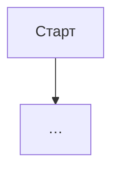

# {Название фичи} — системная спецификация (SA)

> Шаблон процесса. Заполни секции и сохрани как `docs/work/{FEATURE}_SA_SPEC.md`.
> Пустой раздел — пиши «нет» с причиной, не удаляй заголовок.
> Код новой фичи начинается после статуса **Согласовано**.

| Поле | Значение |
|------|----------|
| **ID** | F-{XXX} |
| **Назначение** | Одно предложение: что даёт человеку |
| **Источник** | решение владельца (строка бэклога) / исследование / … |
| **Статус** | Черновик · **Согласовано** · В разработке · Релиз {version} · Прототип · План · Removed {version} |
| **Версия спеки** | {дата} — что изменилось |
| **Связанные** | F-… · `docs/work/FEATURE_BEHAVIOR.md` · план `docs/superpowers/plans/…` |

---

## Содержание

1. Контекст
2. Цель
3. Бизнес-требования
4. Описание
5. Сценарии
6. Функциональные требования
7. Матрица исходов
8. NFR
9. Архитектурные решения
10. API и контракты
11. Зависимости и релиз
12. Открытые вопросы
13. Приложения

---

## 1. Контекст

Зачем фича, для кого, как устроено сейчас. Ограничения бери из `docs/work/BACKLOG.md`, не выдумывай новые.

---

## 2. Цель

Одна формулировка и признак, по которому видно, что цель достигнута.

---

## 3. Бизнес-требования

| ID | Требование | Приоритет |
|----|------------|-----------|
| BR-01 | … | Must / Should / Could / Вне этой фичи |

---

## 4. Описание

### 4.1 Как сейчас

### 4.2 Как будет

### 4.3 Поток

### 4.4 Что затронуто

| Слой | Путь |
|------|------|
| Клиент | … |
| Сервер | … |
| Хранение | … |
| Внешнее | … |

Стек выбран (Р-13): TypeScript в браузере и на сервере, React, TipTap, Yjs, Postgres. Если спека про будущую фичу из «Позже», где язык ещё не записан в «Решения», пиши роль слоя, не язык.

---

## 5. Сценарии

| UC | Кто | Цель | Предусловия |
|----|-----|------|-------------|
| UC-01 | Человек | … | … |

### UC-01 — {название}

Шаги: 1. … 2. … Результат: …

---

## 6. Функциональные требования

| ID | Требование | Проверка |
|----|------------|----------|
| FR-01 | … | тест `…` или ручная проверка V-… |

У каждого FR есть проверка.

---

## 7. Матрица исходов

### Успех

| ID | Условие | Что видит человек |
|----|---------|-------------------|

### Отказ

| ID | Условие | Текст на русском и что происходит дальше |
|----|---------|------------------------------------------|

---

## 8. NFR

| ID | Категория | Требование |
|----|-----------|------------|
| NFR-01 | Доступ | … |
| NFR-02 | Скорость | … |
| NFR-03 | Экран | … |
| NFR-04 | Сбой | … |

---

## 9. Архитектурные решения

| ID | Решение | Альтернативы | Почему |
|----|---------|--------------|--------|
| ADR-01 | … | … | строка бэклога, если решал владелец |

---

## 10. API и контракты

| Вид | Имя | Вход → выход | Зачем |
|-----|-----|--------------|-------|
| Вызов клиента к серверу | … | … | … |
| Событие | … | … | … |
| Хранилище | … | формат, версия | … |
| Внешний сервис | … | … | … |

---

## 11. Зависимости и релиз

| Зависимость | Тип |
|-------------|-----|
| F-… | Блокер / можно позже |

Тексты для человека — на русском.

---

## 12. Открытые вопросы

| # | Вопрос | Статус |
|---|--------|--------|
| 1 | … | Открыт. Пока делаем так: … |

Вопрос, которого не было в разговоре с владельцем, остаётся здесь с ответом по умолчанию. В тихом виде в код он не уходит.

---

## 13. Приложения

Макеты, снимки, ссылки на план, пункты ручной проверки.
