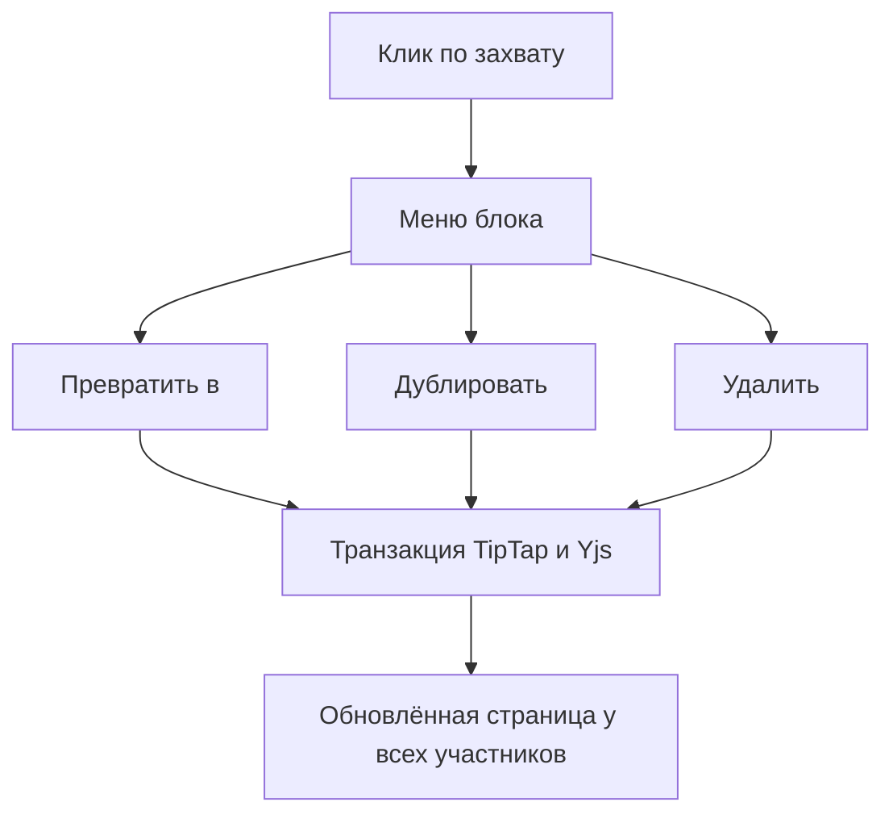

# Действия с блоком — системная спецификация (SA)

| Поле | Значение |
|------|----------|
| **ID** | F-002 |
| **Назначение** | Человек превращает, дублирует, удаляет и перетаскивает блок через один захват слева от текста. |
| **Источник** | Р-11, Р-19; первый срез подтверждён владельцем 2026-11-04. |
| **Статус** | Реализовано и проверено 2026-11-04 |
| **Версия спеки** | 2026-11-04 — первая поставка действий с блоком. |
| **Связанные** | F-001 · `docs/work/FEATURE_BEHAVIOR.md` · план `docs/superpowers/plans/2026-11-04-block-actions.md` |

## 1. Контекст

В редакторе уже есть захват перетаскивания TipTap, но клик по нему не даёт действий. Slash-меню умеет выбирать тип нового блока, однако не решает операции над существующим блоком.

## 2. Цель

Человек открывает меню через `⋮⋮`, выполняет одно из трёх действий и сразу видит результат; перетаскивание продолжает работать тем же захватом. Изменения проходят через существующий Yjs-документ и видны второму участнику.

## 3. Бизнес-требования

| ID | Требование | Приоритет |
|----|------------|-----------|
| BR-01 | Один захват совмещает клик и перетаскивание. | Must |
| BR-02 | Доступны превращение, дублирование и удаление; неготовые действия не показываются. | Must |
| BR-03 | Операции не требуют нового API и синхронизируются существующим механизмом. | Must |
| BR-04 | Цвет, комментарий, ссылка на блок, перенос на страницу и множественное выделение. | Вне этой фичи |

## 4. Описание

### 4.1 Как сейчас

Захват только перетаскивает блок. Существующий документ нельзя дублировать или удалить через его меню.

### 4.2 Как будет

Клик открывает компактное меню рядом с захватом. «Превратить в» раскрывает поддерживаемые типы. Дубликат появляется сразу после источника. Удаление выполняется сразу, без модального окна. Если удалён последний блок, редактор оставляет пустой абзац.

### 4.3 Поток

### 4.4 Что затронуто

| Слой | Путь |
|------|------|
| Клиент | `app/src/` |
| Сервер | Не меняется |
| Хранение | Существующий Yjs-снимок, схема не меняется |
| Внешнее | Нет |

## 5. Сценарии

| UC | Кто | Цель | Предусловия |
|----|-----|------|-------------|
| UC-01 | Участник | Изменить тип блока | Страница открыта для правки |
| UC-02 | Участник | Создать копию блока | Есть исходный блок |
| UC-03 | Участник | Удалить блок | Есть блок |
| UC-04 | Участник | Переместить блок | Есть блок и цель перетаскивания |

### UC-01 — Превращение

Открыть `⋮⋮` → «Превратить в» → выбрать текст, заголовок 1–3, один из трёх списков, цитату или код. Содержимое блока сохраняется. Для таблицы, картинки и разделителя превращение недоступно.

### UC-02 — Дублирование

Выбрать «Дублировать». Полная копия блока, включая форматирование и вложенное содержимое, встаёт сразу после источника.

### UC-03 — Удаление

Выбрать «Удалить». Блок исчезает без подтверждения. Пустая страница сохраняет пустой абзац для продолжения ввода.

### UC-04 — Перетаскивание

Зажать тот же `⋮⋮`, переместить блок к направляющей и отпустить. Клик без движения не меняет документ.

## 6. Функциональные требования

| ID | Требование | Проверка |
|----|------------|----------|
| FR-01 | Клик открывает меню, Escape закрывает его и возвращает фокус захвату. | Браузерная проверка V-01 |
| FR-02 | Меню поддерживает стрелки, Enter/Space и имеет доступные имена. | Браузерная проверка V-01 |
| FR-03 | Превращение сохраняет текст и поддерживает перечисленные типы. | Юнит-тесты команд редактора |
| FR-04 | Дублирование сохраняет содержимое и вставляет копию после источника. | Юнит-тест команды |
| FR-05 | Удаление убирает выбранный блок; последний блок заменяется пустым абзацем. | Юнит-тест команды |
| FR-06 | Перетаскивание тем же захватом продолжает работать. | Браузерная проверка V-02 |
| FR-07 | Операции проходят через TipTap-транзакции и не добавляют серверный контракт. | Тесты существующей совместной правки |
| FR-08 | Меню использует общие токены, не перекрывает границы viewport и имеет touch-цель 44 × 44. | Браузерная проверка V-03 |

## 7. Матрица исходов

### Успех

| ID | Условие | Что видит человек |
|----|---------|-------------------|
| S-01 | Дубликат создан | Копия непосредственно под исходным блоком |
| S-02 | Тип изменён | Тот же текст в новом оформлении |
| S-03 | Блок удалён | Соседние блоки сомкнулись |

### Отказ

| ID | Условие | Текст на русском и что происходит дальше |
|----|---------|------------------------------------------|
| E-01 | Превращение не поддерживается | Пункт «Превратить в» отключён; документ не меняется |
| E-02 | Позиция блока устарела после живой правки | Меню закрывается без операции; человек повторяет действие |

## 8. NFR

| ID | Категория | Требование |
|----|-----------|------------|
| NFR-01 | Доступ | Используются существующие права страницы; новых обходов нет. |
| NFR-02 | Скорость | Операция локальная, без сетевого запроса; меню не вызывает постоянных перерисовок редактора. |
| NFR-03 | Экран | Общие токены Wiki; клавиатура и touch-цель 44 × 44; меню остаётся в viewport. |
| NFR-04 | Сбой | Устаревшая позиция не приводит к изменению другого блока. |

## 9. Архитектурные решения

| ID | Решение | Альтернативы | Почему |
|----|---------|--------------|--------|
| ADR-01 | Операции изолированы в команды над редактором TipTap. | Прямые манипуляции DOM | Сохраняются Yjs-синхронизация и корректная схема документа |
| ADR-02 | Меню использует Radix DropdownMenu и существующий DragHandle. | Собственная система фокуса и позиционирования | Клавиатура, возврат фокуса и viewport уже решены |
| ADR-03 | Один реестр типов для подменю превращения. | Отдельные подписи и обработчики для каждого пункта | Единое поведение и повторное использование иконок |

## 10. API и контракты

| Вид | Имя | Вход → выход | Зачем |
|-----|-----|--------------|-------|
| Команда клиента | Превратить блок | позиция, тип → TipTap-транзакция | Изменение типа |
| Команда клиента | Дублировать блок | позиция → копия после источника | Повтор содержимого |
| Команда клиента | Удалить блок | позиция → удаление или пустой абзац | Удаление содержимого |
| HTTP/WebSocket | Новых контрактов нет | Существующая синхронизация Yjs | Живая правка |

## 11. Зависимости и релиз

| Зависимость | Тип |
|-------------|-----|
| F-001 | Блокер, уже реализован |
| Дизайн-система Wiki и P20 | Блокер, готовы |

Тексты человека — на русском. Релиз среза — проверенный локально интерфейс без новых серверных зависимостей.

## 12. Открытые вопросы

| # | Вопрос | Статус |
|---|--------|--------|
| 1 | Множественное выделение и групповые операции | Не входят; следующий срез |
| 2 | Цвет, комментарий, ссылка и перенос блока | Не показываются до отдельной реализации |
| 3 | Превращение таблицы, картинки и разделителя | Пункт отключён; правило не выдумываем |

## 13. Приложения

Макет: Figma `02 · Product / Full scope`, P20 «Меню блока».

V-01: открыть меню мышью и клавиатурой, пройти подменю стрелками, закрыть через Escape и проверить возврат фокуса.

V-02: перетащить абзац и вложенный пункт списка тем же захватом; проверить отсутствие открытия меню после drag.

V-03: проверить desktop и 375 px, отсутствие обрезания меню, touch-цели и горизонтального переполнения.

Результаты 2026-11-04: V-01—V-03 пройдены; абзац и вложенный пункт списка перетаскиваются без открытия меню. Полный прогон — 31 тест, сборка успешна. Мутационная проверка `app/scripts/mutation-check-block-operations.mjs` — 9/9 мутаций убиты, 15 тестов операций. Общий lint содержит 17 ранее существовавших ошибок вне этого среза; новых замечаний к F-002 нет.
