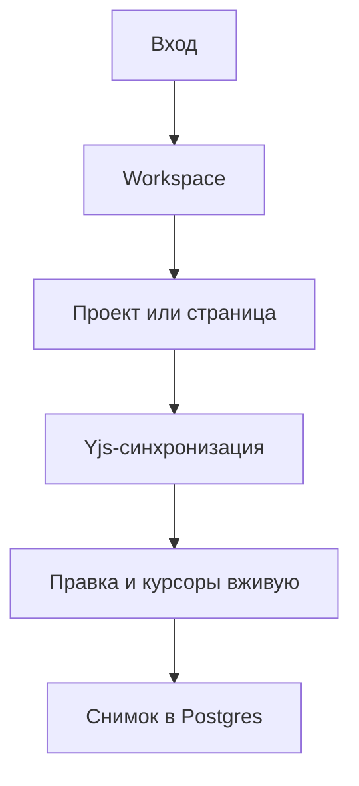

# Редактор — системная спецификация (SA)

| Поле | Значение |
|------|----------|
| **ID** | F-001 |
| **Назначение** | Человек ведёт дерево страниц и правит Markdown вместе с другими участниками вживую. |
| **Источник** | Р-2, Р-7, Р-11 — Р-17; запуск реализации подтверждён владельцем 2026-11-03. |
| **Статус** | Реализовано и проверено |
| **Версия спеки** | 2026-11-03 — первая поставка редактора. |
| **Связанные** | `docs/work/FEATURE_BEHAVIOR.md` · план `docs/superpowers/plans/2026-11-03-editor.md` |

## 1. Контекст

Кода нет. Первым идёт клиент-серверный редактор: учётная запись по почте и паролю, workspace, проекты как корневые страницы, дерево страниц, Markdown, перетаскивание и живая правка. Поиск, круги доступа, входящие, комментарии, агенты, граф и плагины не входят.

## 2. Цель

Два участника одного workspace открывают одну страницу в двух браузерах, правят текст и блоки, видят изменения и курсоры друг друга без перезагрузки; после перезапуска сервера дерево и текст сохраняются.

## 3. Бизнес-требования

| ID | Требование | Приоритет |
|----|------------|-----------|
| BR-01 | Вход и регистрация по почте и паролю; регистрация управляется env. | Must |
| BR-02 | Регистрация создаёт workspace и первый проект. | Must |
| BR-03 | Дерево поддерживает страницы произвольной вложенности, создание, переименование, порядок и перенос. | Must |
| BR-04 | Текст редактируется блоками и выгружается в Markdown. | Must |
| BR-05 | Правки и курсоры участников видны вживую. | Must |
| BR-06 | Данные сохраняются в Postgres. | Must |
| BR-07 | Поиск, доступ по кругам, входящие и приглашения. | Вне этой фичи |

## 4. Описание

### 4.1 Как сейчас

Реализована первая поставка в `app/`: интерфейс, сервер, встроенный Postgres и совместное редактирование. Основные сценарии проверены API-тестами и в двух браузерных контекстах, включая перезапуск сервера и мобильную раскладку.

### 4.2 Как будет

Один процесс отдаёт React-интерфейс, REST API и WebSocket. TipTap редактирует Yjs-документ. Hocuspocus передаёт операции и awareness, проверяет сессию и участие в workspace. Postgres хранит учётные записи, серверные сессии, workspace, участников, страницы и снимки Yjs. Локальный запуск использует встроенный Postgres (PGlite); внешний Postgres подключается через `DATABASE_URL`.

### 4.3 Поток

### 4.4 Что затронуто

| Слой | Путь |
|------|------|
| Клиент | `app/src/` |
| Сервер | `app/server/` |
| Хранение | `app/server/db/`, `app/data/` локально |
| Внешнее | нет |

## 5. Сценарии

| UC | Кто | Цель | Предусловия |
|----|-----|------|-------------|
| UC-01 | Человек | Создать учётную запись и начать страницу | Регистрация включена |
| UC-02 | Участник | Вести дерево проекта | Есть сессия и участие |
| UC-03 | Участник | Писать и оформлять Markdown | Открыта страница |
| UC-04 | Два участника | Править одну страницу вживую | Общий workspace |
| UC-05 | Участник | Выгрузить страницу | Открыта страница |

### UC-01 — Регистрация

Ввести имя, почту и пароль. Сервер атомарно создаёт учётную запись, workspace, владельца и проект «Мой первый проект». Человек попадает в редактор.

### UC-02 — Дерево

Создать проект или дочернюю страницу, переименовать, перетащить на узел или между узлами. Сервер не допускает перенос в собственного потомка и сохраняет порядок.

### UC-03 — Markdown

Писать с Markdown-сочетаниями и меню `/`: заголовки, списки, дела, цитаты, код, разделитель, таблица, ссылки и картинки. Кнопка «Markdown» скачивает текущую страницу как `.md`.

### UC-04 — Живая правка

Два участника открывают страницу. Правки сливаются Yjs без блокировки блока. Имена и цветные курсоры видны; состояние соединения показано без перезагрузки.

## 6. Функциональные требования

| ID | Требование | Проверка |
|----|------------|----------|
| FR-01 | Регистрация создаёт ровно одну учётную запись, workspace, владельца и проект. | Интеграционный тест регистрации |
| FR-02 | Пароль хранится только как Argon2/bcrypt-хэш; неверная почта и пароль дают одинаковую ошибку. | Тест входа |
| FR-03 | `REGISTRATION_ENABLED=false` запрещает регистрацию, но не вход. | Тест настройки |
| FR-04 | Выход удаляет серверную сессию. | Тест выхода |
| FR-05 | Все операции со страницами ограничены участниками workspace. | Тест чужого workspace и WebSocket |
| FR-06 | Создание страницы и проекта, переименование и выбор страницы работают без перезагрузки. | E2E дерева |
| FR-07 | Перенос на узел делает страницу дочерней, перенос между узлами меняет порядок. | Тесты перемещения + E2E |
| FR-08 | Перенос в себя или потомка отклоняется без изменения дерева. | Тест цикла |
| FR-09 | Поддержаны абзац, H1–H3, три списка, цитата, код, разделитель, таблица, ссылка, жирный, курсив, зачёркнутый, встроенный код и картинка. | Тест Markdown round-trip + E2E |
| FR-10 | Markdown скачивается файлом с названием страницы. | E2E экспорта |
| FR-11 | Правка второго участника появляется у первого без перезагрузки. | Тест двух WebSocket-клиентов + E2E |
| FR-12 | Awareness показывает имя, аватар и курсор другого участника. | E2E двух контекстов |
| FR-13 | Yjs-снимок восстанавливается после перезапуска. | Интеграционный тест сохранения |
| FR-14 | Страница имеет иконку и обложку, их можно изменить и убрать. | E2E оформления |
| FR-15 | Блоки можно перетаскивать с видимой направляющей. | Ручная проверка V-01 |
| FR-16 | Все видимые элементы управления имеют действие, состояния hover/focus/disabled. | Браузерная проверка |

## 7. Матрица исходов

### Успех

| ID | Условие | Что видит человек |
|----|---------|-------------------|
| S-01 | Вход выполнен | Workspace и последняя доступная страница |
| S-02 | Соединение активно | «В сети», правки и присутствие |
| S-03 | Снимок записан | «Сохранено» без модального окна |

### Отказ

| ID | Условие | Текст на русском и что происходит дальше |
|----|---------|------------------------------------------|
| E-01 | Неверные учётные данные | «Не удалось войти. Проверьте почту и пароль.» Поля остаются |
| E-02 | Регистрация выключена | «Регистрация сейчас закрыта.» Вход доступен |
| E-03 | Нет доступа | «Страница не найдена.» Данные чужого workspace не раскрываются |
| E-04 | Цикл дерева | «Нельзя переместить страницу внутрь самой себя.» Дерево не меняется |
| E-05 | WebSocket отключился | «Восстанавливаем связь…» Правки продолжаются локально и синхронизируются после соединения |
| E-06 | Системный сбой | «Не получилось выполнить действие. Попробуйте ещё раз.» Подробности только в журнале |

## 8. NFR

| ID | Категория | Требование |
|----|-----------|------------|
| NFR-01 | Доступ | Закрыто по умолчанию; cookie HttpOnly, SameSite=Lax, Secure в production; параметризованные запросы. |
| NFR-02 | Скорость | До пяти участников workspace; API p95 < 300 мс локально, живая доставка < 500 мс при обычной сети. |
| NFR-03 | Экран | Desktop-first; 375 px без горизонтальной прокрутки; текст ≥16 px; клавиатурный фокус виден. |
| NFR-04 | Сбой | Транзакции для составных записей; Yjs допускает повтор и неупорядоченную доставку. |
| NFR-05 | Наблюдение | JSON-журналы с request ID; readiness выполняет `SELECT 1`; RED-счётчики HTTP и число WS-комнат. |

## 9. Архитектурные решения

| ID | Решение | Альтернативы | Почему |
|----|---------|--------------|--------|
| ADR-01 | TypeScript, React, TipTap, Yjs, Postgres, один процесс. | Rust, готовый каркас | Р-13, Р-14 |
| ADR-02 | Hocuspocus как WebSocket-сервер. | Свой протокол, WebRTC | Официальная интеграция, cookie-auth и сохранение |
| ADR-03 | PGlite для локального запуска, `pg` для `DATABASE_URL`. | Требовать Docker | Нулевая локальная инфраструктура, тот же SQL Postgres |
| ADR-04 | Серверные сессии в Postgres. | JWT | Отзыв удалением строки, нет токена в localStorage |
| ADR-05 | Yjs-снимок — источник текста, Markdown формируется из него. | Два независимых источника | Нет расхождения копий |

## 10. API и контракты

| Вид | Имя | Вход → выход | Зачем |
|-----|-----|--------------|-------|
| HTTP | `POST /api/auth/register` | имя, почта, пароль → сессия и workspace | Регистрация |
| HTTP | `POST /api/auth/login` | почта, пароль → сессия | Вход |
| HTTP | `POST /api/auth/logout` | cookie → удаление сессии | Выход |
| HTTP | `GET /api/bootstrap` | cookie → человек, workspace, дерево | Начальное состояние |
| HTTP | `POST /api/workspaces` | название → workspace и проект | Новый workspace |
| HTTP | `POST /api/pages` | workspace, родитель, название, позиция → страница | Создание |
| HTTP | `PATCH /api/pages/:id` | разрешённые поля → страница | Название и оформление |
| HTTP | `POST /api/pages/:id/move` | родитель и позиция → дерево | Перенос |
| HTTP | `GET /api/pages/:id/markdown` | cookie → Markdown | Выгрузка |
| WebSocket | `page.<uuid>` | Yjs и awareness | Живая правка |
| Хранилище | `pages.yjs_state` | bytea, обновляется debounce | Сохранённый текст |
| Ошибка | `{error:{code,message}}` | HTTP 4xx/5xx | Стабильная обработка |

## 11. Зависимости и релиз

| Зависимость | Тип |
|-------------|-----|
| Node.js 22+ | Блокер |
| Внешние сервисы | Нет |
| Статическая публикация | Неприменимо: нужны API, сессии, Postgres и WebSocket |

Тексты человека — на русском. Релизом этой задачи является проверенный локально запускаемый продукт, не публичный хостинг.

## 12. Открытые вопросы

| # | Вопрос | Статус |
|---|--------|--------|
| 1 | О-10: конфликт одного места | Не блокирует: Yjs сливает операции; продуктового правила «последнее изменение» не объявляем. |
| 2 | Приглашение второго участника | Вне поставки; тесты создают участие напрямую в хранилище. |
| 3 | Публичное развёртывание | Отдельная задача; эта поставка запускается локально. |

## 13. Приложения

Визуальная рамка: панель 280 px слева, текст до 760 px по центру, оглавление справа от 1200 px; фон `#f7f8f5`, чернильный текст, зелёный акцент, Onest + PT Serif, движение 160–220 мс. Компоненты: поля и кнопки формы, дерево, строка страницы, меню блока, панель присутствия, всплывающие меню, уведомление. Все новые, общего набора в коде ещё нет.

V-01: перетащить блок и страницу, проверить направляющую и отсутствие скачка.
V-02: проверить клавиатурой форму, дерево, меню и закрытие поповеров.
