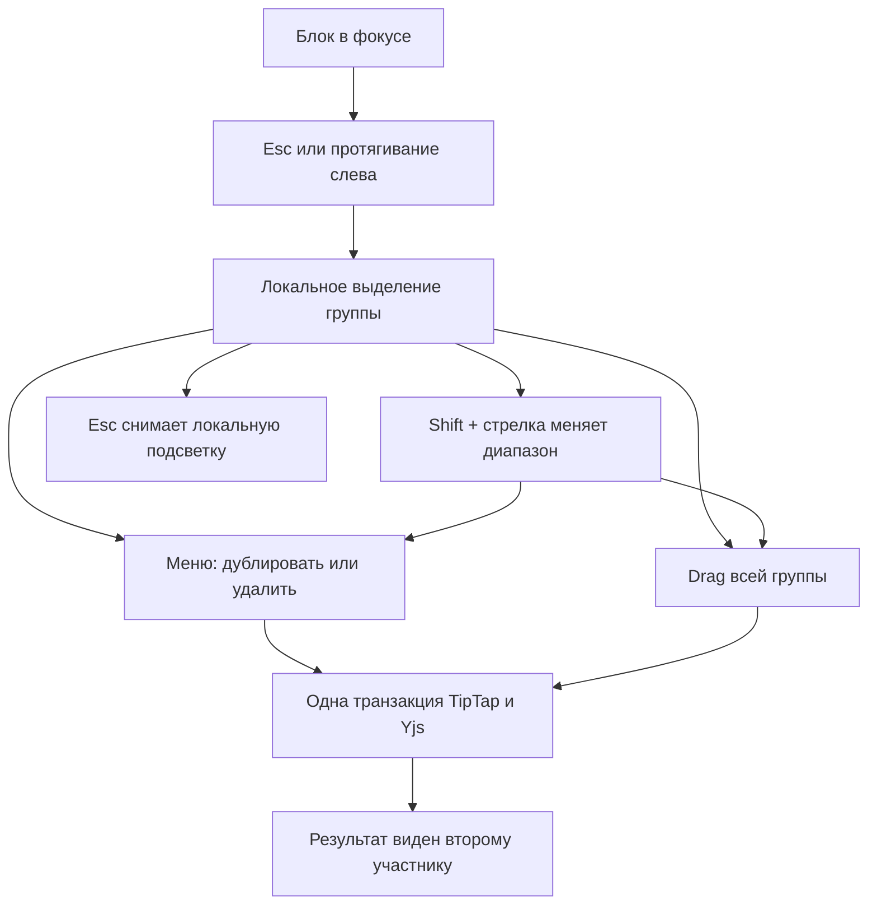

# Группа блоков — системная спецификация (SA)

| Поле | Значение |
|------|----------|
| **ID** | F-003 |
| **Назначение** | Человек выделяет несколько соседних блоков и дублирует, удаляет или перетаскивает их как одну группу. |
| **Источник** | Р-11, Р-20, Р-21; макет P21 согласован владельцем 2026-11-04. |
| **Статус** | Реализовано и проверено 2026-11-05 |
| **Версия спеки** | 2026-11-05 — групповое выделение и операции реализованы; unit, mutation, browser, build и независимый QA пройдены. |
| **Связанные** | F-002 · `docs/work/FEATURE_BEHAVIOR.md` · план `docs/superpowers/plans/2026-11-04-group-blocks.md` · P21 |

## 1. Контекст

F-002 дал операции превращения, дублирования, удаления и перетаскивания для одного блока через существующий захват `⋮⋮`. Сейчас нет режима выделения нескольких блоков: групповые операции невозможны, а установленный `@tiptap/extension-node-range` в редакторе не используется.

Группа — непрерывный диапазон соседних детей одного родителя: несколько блоков страницы или несколько пунктов одного списка. Несмежных блоков и смешанных уровней в группе нет (Р-20, Р-21).

## 2. Цель

Человек выделяет группу клавиатурой или протягиванием слева от текста, затем одним действием дублирует, удаляет или перемещает её. Порядок и содержимое блоков сохраняются, результат синхронизируется через существующий Yjs-документ, а подсветка остаётся локальной.

## 3. Бизнес-требования

| ID | Требование | Приоритет |
|----|------------|-----------|
| BR-01 | Выделение группы доступно клавиатурой и мышью без потери обычного текстового выделения. | Must |
| BR-02 | Для группы доступны только дублирование, удаление и перетаскивание. | Must |
| BR-03 | Группа ограничена непрерывными соседями одного родителя. | Must |
| BR-04 | Операции не требуют нового серверного API и синхронизируются существующим механизмом. | Must |
| BR-05 | Подсветка группы локальна и не становится частью присутствия других участников. | Must |
| BR-06 | Несмежное выделение, групповое превращение и клавиатурный аналог перетаскивания. | Вне этой фичи |

## 4. Описание

### 4.1 Как сейчас

`Esc` закрывает открытое slash-меню, но не переводит текущий блок в блочное выделение. `Shift + ↑/↓` выполняет обычное расширение текстового выделения. Меню захвата всегда показывает действия одного блока, включая «Превратить в». Перетаскивание затрагивает один блок.

### 4.2 Как будет

`Esc` внутри блока выделяет его целиком, повторный `Esc` возвращает обычный режим редактирования. Только после входа в блочный режим `Shift + ↑/↓` двигает подвижный край диапазона: расширяет его к соседу или сокращает при обратном движении. На границе родителя диапазон останавливается. Протягивание по левому полю редактора выделяет непрерывный диапазон, не захватывая соседний уровень вложенности.

Выделенные блоки получают фон `accentSoft` и акцентную кромку 2 px по P21. Меню группы содержит «Дублировать» и «Удалить»; «Превратить в» не показывается. Дубликаты встают сразу после исходной группы в прежнем порядке. После удаления фокус переходит к ближайшему оставшемуся соседу; при удалении всего содержимого страницы остаётся пустой абзац.

Захват любого блока внутри группы перетаскивает всю группу. Захват блока вне группы снимает выделение и перетаскивает только этот блок. Направляющая показывает место вставки. Если цель находится внутри самой группы или не принимает такую последовательность по схеме, документ не меняется.

### 4.3 Поток

### 4.4 Что затронуто

| Слой | Путь |
|------|------|
| Клиент | `app/src/components/Editor.tsx`, `BlockMenu.tsx`, команды выделения и операций, стили `App.css` |
| Сервер | Нет — существующий collaborative transport не меняется |
| Хранение | Нет — существующий Yjs-снимок и схема документа не меняются |
| Внешнее | Нет |

## 5. Сценарии

| UC | Кто | Цель | Предусловия |
|----|-----|------|-------------|
| UC-01 | Участник | Выделить группу клавиатурой | Фокус в блоке страницы |
| UC-02 | Участник | Выделить группу мышью | Указатель на левом поле редактора |
| UC-03 | Участник | Продублировать группу | Есть валидная группа |
| UC-04 | Участник | Удалить группу | Есть валидная группа |
| UC-05 | Участник | Переместить группу | Есть валидная группа и допустимая цель |
| UC-06 | Два участника | Увидеть общий результат без чужой подсветки | Открыта одна страница |

### UC-01 — Клавиатурное выделение

Нажать `Esc` → текущий блок выделен. Нажимать `Shift + ↓` или `Shift + ↑` → подвижный край включает соседей того же родителя. Обратная стрелка сокращает диапазон, если движение идёт к якорю. Повторный `Esc` снимает блочное выделение. До первого `Esc` обычное текстовое выделение через `Shift` сохраняется.

### UC-02 — Выделение мышью

Зажать указатель на левом поле и протянуть через несколько блоков. Выделяется только непрерывный диапазон одного уровня. Обычный захват текста внутри содержимого этим жестом не заменяется.

### UC-03 — Дублирование

Открыть меню у любого выделенного блока → «Дублировать». Полные копии всех блоков появляются сразу после группы в исходном порядке; форматирование и вложенное содержимое сохраняются.

### UC-04 — Удаление

Открыть меню группы → «Удалить». Группа исчезает без модального подтверждения. Фокус переходит к следующему оставшемуся соседу, а если его нет — к предыдущему. Если содержимого не осталось, фокус находится в новом пустом абзаце.

### UC-05 — Перетаскивание

Зажать `⋮⋮` внутри группы и переместить её к направляющей. После отпускания вся последовательность встаёт в допустимое место без изменения внутреннего порядка. Захват вне группы отменяет групповой режим и сохраняет прежнее поведение одиночного drag.

### UC-06 — Совместная правка

Первый участник применяет операцию к группе. Второй видит изменение содержимого, но не видит локальную подсветку выделения первого. Если живая правка сделала сохранённые границы недействительными, операция не применяется к другим блокам.

## 6. Функциональные требования

| ID | Требование | Проверка |
|----|------------|----------|
| FR-01 | Первый `Esc` выделяет текущий блок, повторный снимает блочное выделение. | Юнит-тест переходов и браузер V-01 |
| FR-02 | Открытое меню обрабатывает свой `Esc` первым, закрывается и возвращает фокус захвату; следующий `Esc` управляет выделением. | Браузер V-01 |
| FR-03 | `Shift + ↑/↓` в блочном режиме расширяет и сокращает подвижный край, останавливаясь на границе родителя. | Юнит-тесты диапазона и браузер V-01 |
| FR-04 | До блочного режима `Shift + ↑/↓` сохраняет обычное текстовое выделение. | Браузер V-01 |
| FR-05 | Протягивание слева создаёт только непрерывный диапазон соседей одного родителя. | Юнит-тест нормализации и браузер V-02 |
| FR-06 | Подсветка соответствует P21, локальна и не передаётся через awareness. | Браузер V-02 и V-06 |
| FR-07 | Меню группы содержит «Дублировать» и «Удалить», но не содержит «Превратить в». | Браузер V-03 |
| FR-08 | Дублирование сохраняет содержимое и порядок, вставляя копии сразу после группы одной транзакцией. | Юнит-тест команды |
| FR-09 | Удаление убирает только группу; после удаления всего содержимого остаётся пустой абзац. | Юнит-тест команды |
| FR-10 | После удаления фокус получает ближайший оставшийся сосед или пустой абзац. | Юнит-тест команды и браузер V-03 |
| FR-11 | Захват внутри группы перемещает всю последовательность; направляющая и итоговый порядок корректны. | Юнит-тест перемещения и браузер V-04 |
| FR-12 | Захват вне группы снимает её и перемещает один блок, как в F-002. | Браузер V-04 |
| FR-13 | Недопустимая цель, цель внутри группы и устаревшие границы не меняют документ и не затрагивают чужие блоки. | Юнит-тесты отказов |
| FR-14 | Каждая групповая операция проходит через TipTap/Yjs и видна второму участнику без нового API. | Существующий collaborative test и браузер V-06 |

## 7. Матрица исходов

### Успех

| ID | Условие | Что видит человек |
|----|---------|-------------------|
| S-01 | Группа выделена | Непрерывная подсветка и акцентная кромка выбранных блоков |
| S-02 | Группа продублирована | Копии в прежнем порядке сразу после оригиналов |
| S-03 | Группа удалена | Соседние блоки сомкнулись, фокус не потерян |
| S-04 | Группа перемещена | Вся последовательность находится у направляющей |
| S-05 | Выделение снято | Обычный курсор и редактирование текста восстановлены |

### Отказ

| ID | Условие | Текст на русском и что происходит дальше |
|----|---------|------------------------------------------|
| E-01 | Попытка выйти за границу родителя | Отдельного сообщения нет; диапазон остаётся на последнем допустимом соседе |
| E-02 | Недопустимая цель drag | Отдельного сообщения нет; документ сохраняет прежний порядок |
| E-03 | Границы устарели после живой правки | Отдельного сообщения нет; меню закрывается или операция не выполняется, человек повторяет выделение |
| E-04 | Открыто меню и нажат `Esc` | Меню закрывается, группа остаётся выделенной, фокус возвращается захвату |

## 8. NFR

| ID | Категория | Требование |
|----|-----------|------------|
| NFR-01 | Доступ | Используются существующие права страницы; клавиатурный вход и выход из режима предсказуемы, фокус не теряется. |
| NFR-02 | Скорость | Выделение и команды выполняются локально, без сетевого запроса; обработчики не создают постоянных перерисовок при простое. |
| NFR-03 | Экран | Цвета, кромка, меню и захват используют общие токены Wiki и P21; меню остаётся в viewport, горизонтального переполнения нет. |
| NFR-04 | Сбой | Невалидный диапазон не приводит к частичной операции или изменению блока по случайной позиции. |
| NFR-05 | Совместимость | F-001, F-002, обычное текстовое выделение, slash-меню и одиночный drag сохраняют прежнее поведение. |

## 9. Архитектурные решения

| ID | Решение | Альтернативы | Почему |
|----|---------|--------------|--------|
| ADR-01 | Выделение представлено якорем и подвижным краем с проверкой общего родителя и непрерывности. | Список произвольных DOM-элементов | Соответствует Р-20 и Р-21, переживает нормальное отображение позиций ProseMirror |
| ADR-02 | Использовать `NodeRangeSelection`, `getSelectionRanges` и примитивы установленного пакета, но собственный вход через `Esc` и обработчики клавиш. | Подключить расширение целиком | Его стандартные `Shift + ↑/↓` входят в блочный режим без `Esc` и нарушили бы FR-04 |
| ADR-03 | Групповые операции изолированы в командах над реальным документом TipTap и выполняются одной транзакцией. | Прямые манипуляции DOM или несколько независимых действий | Сохраняются схема, Yjs-синхронизация и атомарность |
| ADR-04 | Групповой drag интегрируется с существующим TipTap DragHandle; перед его стандартной обработкой определяется, находится ли захваченный блок внутри группы. | Второй независимый механизм перетаскивания | Сохраняются текущая направляющая, nested drag и жест одиночного блока |
| ADR-05 | Подсветка остаётся в локальном selection/decorations и не записывается в awareness. | Поле присутствия для выделенных блоков | Прямое требование Р-21 |

## 10. API и контракты

| Вид | Имя | Вход → выход | Зачем |
|-----|-----|--------------|-------|
| Модель клиента | Непрерывный диапазон | якорь, подвижный край → провалидированные sibling ranges | Единые границы группы |
| Команда клиента | Дублировать группу | валидный диапазон → копии после группы | Повтор содержимого |
| Команда клиента | Удалить группу | валидный диапазон → удаление и соседний фокус | Удаление содержимого |
| Команда клиента | Переместить группу | валидный диапазон, цель → новая последовательность или без изменений | Групповой drag |
| HTTP/WebSocket | Новых контрактов нет | Существующая синхронизация Yjs | Живая правка |
| Хранилище | Новых полей и миграций нет | Существующий Yjs-снимок | Сохранение страницы |
| Внешний сервис | Нет | — | Фича работает внутри текущего редактора |

## 11. Зависимости и релиз

| Зависимость | Тип |
|-------------|-----|
| F-001 | Блокер, уже реализован |
| F-002 | Блокер, уже реализован |
| `@tiptap/extension-node-range` 3.32.2 | Уже установлен; использовать выборочно |
| Дизайн-система Wiki и P21 | Блокер, макет согласован |

Тексты человека — на русском. Релиз среза — проверенный локально интерфейс без новых серверных зависимостей.

## 12. Открытые вопросы

| # | Вопрос | Статус |
|---|--------|--------|
| 1 | Несмежное выделение через `Cmd/Ctrl + click` | Не входит по Р-20 |
| 2 | Смешанные уровни в одной группе | Не входят по Р-21 |
| 3 | Групповое «Превратить в» | Не входит по Р-20 |
| 4 | Клавиатурное перемещение группы | Не придумываем; отдельный будущий срез |
| 5 | Передача подсветки другим участникам | Не входит по Р-21 |

## 13. Приложения

Макет: Figma `02 · Product / Full scope`, P21 «Группа блоков / Desktop», frameId `14:1598`. Экспорт: `design/figma/product-exports/21-группа-блоков.png`.

V-01: проверить `Esc`, повторный `Esc`, расширение и сокращение обеими стрелками, границы родителя, приоритет `Esc` у меню и обычное текстовое выделение через `Shift`.

V-02: протянуть выделение слева на desktop, проверить непрерывность, один уровень и подсветку по P21.

V-03: открыть меню группы, проверить отсутствие «Превратить в», дублирование, удаление, соседний фокус и пустой абзац; повторить на 375 px.

V-04: перетащить группу за захват внутри неё; затем захватить блок вне группы и проверить снятие выделения и одиночный drag; проверить отказ цели внутри группы.

V-05: прогнать юнит-тесты каждого FR, полный набор, typecheck, сборку и мутационную проверку ветвлений, границ и побочных эффектов групповых операций; все мутации должны быть убиты, исходник восстановлен.

V-06: два браузерных клиента на одной странице: дублирование, удаление и перемещение синхронизируются; подсветка первого участника у второго не появляется; живая правка не приводит к операции по чужим блокам.

Фактическая проверка 2026-11-05: 81/81 unit passed, 42/42 мутаций убиты, 21/21 браузерных сценариев passed, TypeScript и production build успешны. Независимый QA: PASS, подтверждённых дефектов и регрессий F-002 нет. Отчёт: `qa-bug-hunt/bug-report-20261104-211358-f003-group-blocks.md`.
