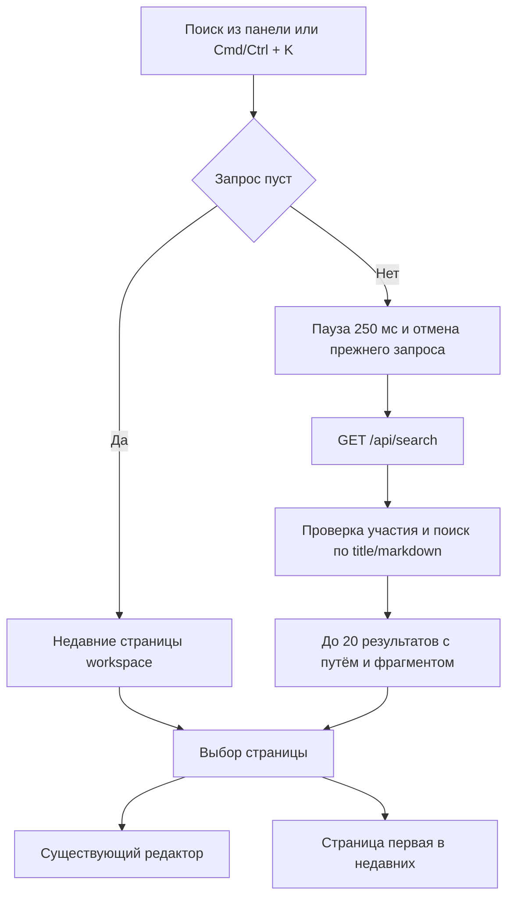

# Поиск по страницам — системная спецификация (SA)

| Поле | Значение |
|------|----------|
| **ID** | F-004 |
| **Назначение** | Участник быстро находит страницу текущего workspace по названию или тексту и открывает её. |
| **Источник** | Р-8, Р-22, П-12; первый срез подтверждён владельцем 2026-11-04. |
| **Статус** | Реализовано и проверено 2026-11-05 |
| **Версия спеки** | 2026-11-05 — первый срез реализован; unit, mutation, browser, load, build и независимый QA пройдены. |
| **Связанные** | F-001 · `docs/work/FEATURE_BEHAVIOR.md` · план `docs/superpowers/plans/2026-11-04-search.md` · P03/P15 |

## 1. Контекст

В редакторе есть дерево страниц, Markdown и живая правка. F-004 добавила поиск по содержимому: теперь страницу можно открыть через дерево, результаты поиска и список недавних.

Сервер хранит название и Markdown каждой страницы. Совместная правка обновляет сохранённый Markdown через существующий механизм Yjs. Текущая модель доступа допускает участника только к страницам workspace, в котором у него есть участие; круги доступа и права отдельных страниц ещё не реализованы.

P03 «Поиск / Desktop» и P15 «Поиск / Mobile» согласованы владельцем 2026-11-05 и реализованы в текущем экране поиска.

## 2. Цель

Участник открывает поиск кнопкой или `Cmd/Ctrl + K`, вводит запрос и открывает нужную страницу по совпадению в названии или сохранённом Markdown. Цель достигнута, когда поиск возвращает только страницы текущего доступного workspace, показывает достаточный контекст для выбора и работает клавиатурой, мышью и на mobile.

## 3. Бизнес-требования

| ID | Требование | Приоритет |
|----|------------|-----------|
| BR-01 | Искать по названию и тексту, а не только фильтровать дерево. | Must |
| BR-02 | Ограничить выдачу страницами текущего workspace, доступного участнику. | Must |
| BR-03 | Показать название, путь и фрагмент текста, чтобы отличить похожие страницы. | Must |
| BR-04 | Открыть найденную страницу в существующем редакторе. | Must |
| BR-05 | При пустом запросе показать недавно открытые страницы этого человека в текущем workspace. | Must |
| BR-06 | Поддержать desktop, mobile и работу с клавиатуры. | Must |
| BR-07 | Поиск внутри открытой страницы. | Вне этой фичи |
| BR-08 | Скрытие общедоступных страниц из выдачи и поиск по кругам доступа. | Вне этой фичи |
| BR-09 | Полнотекстовые операторы, фильтры, RAG и поиск для моделей. | Вне этой фичи |

## 4. Описание

### 4.1 До F-004

В боковой панели были только создание страниц и дерево. Отдельного экрана поиска, клиентского запроса по тексту и серверного поискового API не было. В bootstrap приходили метаданные страниц текущего workspace, но не их Markdown.

### 4.2 Реализованное поведение

В верхней части боковой панели появляется пункт «Поиск». Он и сочетание `Cmd/Ctrl + K` открывают поиск и ставят фокус в единственное поле запроса. На desktop поиск занимает основную область по P03, на mobile — полноэкранное представление по P15. «Отмена» на mobile и `Esc` возвращают человека к странице, на которой он был.

Пустой или состоящий только из пробелов запрос показывает до 10 недавно открытых страниц текущего workspace. Открытие страницы через дерево, недавние или результаты поднимает её в начало этого списка и убирает повтор. В первом срезе история хранится локально в браузере и разделена по человеку и workspace; между устройствами она не синхронизируется.

После ввода непустого запроса клиент с паузой 250 мс запрашивает сервер. Запрос обрезается по краям, имеет длину от 1 до 200 символов и ищется как литеральная подстрока без учёта регистра в названии и сохранённом Markdown. Символы `%` и `_` не становятся специальными условиями поиска. Минус-слова, кавычки и `OR` не интерпретируются как операторы.

Сервер возвращает не более 20 страниц. Сначала идут совпадения в названии, затем только в тексте; внутри групп — по убыванию `updatedAt`, затем по `id` для стабильного порядка. Для каждого результата показываются иконка, название, путь от корня и короткий фрагмент текста. HTML из Markdown не вставляется в интерфейс.

`↑/↓` перемещают активный результат, `Enter` открывает его, `Esc` закрывает поиск. Выбор результата открывает существующий редактор и обновляет недавние страницы. При смене workspace запрос, выдача и активный результат сбрасываются; недавние показываются уже для нового workspace.

### 4.3 Поток

### 4.4 Что затронуто

| Слой | Путь |
|------|------|
| Клиент | `app/src/App.tsx`, `app/src/components/Sidebar.tsx`, новый экран поиска и результаты, `app/src/lib/api.ts`, типы и стили |
| Сервер | `app/server/app.ts`, новый модуль поиска, HTTP-тесты |
| Хранение | Существующие `pages.title`, `pages.markdown`, `pages.parent_id`; новых таблиц и миграций нет |
| Внешнее | Нет |

F-003 не затрагивается: поиск не меняет выделение, команды блоков, меню блока или перетаскивание. Редактор используется только как существующий экран открытой страницы.

## 5. Сценарии

| UC | Кто | Цель | Предусловия |
|----|-----|------|-------------|
| UC-01 | Участник | Открыть поиск | Человек вошёл и выбрал workspace |
| UC-02 | Участник | Найти страницу по названию | Есть доступная страница с совпадением |
| UC-03 | Участник | Найти страницу по тексту | Сохранённый Markdown содержит совпадение |
| UC-04 | Участник | Открыть недавнюю страницу | В текущем workspace уже открывали страницы |
| UC-05 | Участник | Выбрать результат клавиатурой | Показаны результаты или недавние |
| UC-06 | Участник | Найти страницу на mobile | Открыт workspace на узком экране |
| UC-07 | Участник двух workspace | Не смешать выдачу и недавние | Есть доступ к двум workspace |
| UC-08 | Человек без участия | Не получить чужие страницы | Известен чужой `workspaceId` |

### UC-01 — Открытие поиска

Нажать «Поиск» или `Cmd/Ctrl + K`. Основная область показывает поиск, фокус находится в поле. При пустом запросе видны недавние страницы либо состояние «Вы ещё не открывали страницы в этом workspace». `Esc` или «Отмена» возвращает прежнюю страницу и фокус.

### UC-02 и UC-03 — Поиск и открытие

Ввести запрос. Во время запроса показывается «Ищем…»; ответ устаревшего запроса не изменяет текущую выдачу. При успехе видны количество результатов и список. Нажатие или `Enter` на активном результате открывает страницу в редакторе.

### UC-04 — Недавние страницы

Очистить поле. Список показывает до 10 последних уникальных страниц текущего workspace, самая свежая первая. Открытие любой страницы обновляет порядок. Скрытая из текущего bootstrap страница не показывается и не открывается из локальной истории.

### UC-07 — Смена workspace

Открыть поиск в первом workspace, затем переключиться на второй и снова открыть поиск. Запрос и прежние результаты отсутствуют, недавние относятся только ко второму workspace.

### UC-08 — Чужой workspace

Отправить поисковый запрос с чужим `workspaceId`. Сервер возвращает `404 WORKSPACE_NOT_FOUND`, без результатов и признаков существования страниц. Аналогично поступает с запросом без действующей сессии через общий `401`.

## 6. Функциональные требования

| ID | Требование | Проверка |
|----|------------|----------|
| FR-01 | «Поиск» и `Cmd/Ctrl + K` открывают поиск и фокусируют поле. | Браузер V-01 |
| FR-02 | Пустой и пробельный запрос не вызывает поисковый API и показывает недавние страницы. | Клиентский тест и браузер V-02 |
| FR-03 | Недавние ограничены 10 уникальными страницами человека и текущего workspace, последняя открытая стоит первой. | Клиентский тест и браузер V-02 |
| FR-04 | Непустой запрос ищет литеральную подстроку без учёта регистра в названии и сохранённом Markdown. | HTTP-тесты |
| FR-05 | `%`, `_`, кавычки, минус и `OR` обрабатываются как обычные символы, а не операторы. | HTTP-тесты |
| FR-06 | Результат содержит `id`, название, иконку, путь, фрагмент, место совпадения и `updatedAt`; полный Markdown и Yjs-снимок не возвращаются. | HTTP-тест контракта |
| FR-07 | Совпадения в названии идут раньше совпадений только в тексте; внутри групп порядок по `updatedAt DESC`, затем `id`. | HTTP-тест |
| FR-08 | Возвращается не более 20 результатов. | HTTP-тест на 21+ совпадение |
| FR-09 | Путь строится от корня до непосредственного родителя и не содержит страниц другого workspace. | HTTP-тест |
| FR-10 | Сервер допускает поиск только при участии человека в указанном workspace. | HTTP-тесты `401`, `404` и успеха участника |
| FR-11 | Клиент не показывает результат устаревшего запроса после изменения текста или workspace. | Клиентский тест и браузер V-03 |
| FR-12 | Открытие результата или недавней страницы показывает её в существующем редакторе и обновляет недавние. | Браузер V-01—V-02 |
| FR-13 | `↑/↓`, `Enter` и `Esc` управляют списком и закрытием; фокус виден и возвращается в прежний контекст. | Браузер V-01 |
| FR-14 | Смена workspace сбрасывает запрос и выдачу, недавние переключаются на новый workspace. | Браузер V-04 |
| FR-15 | Загрузка, отсутствие результата и ошибка имеют отдельные русские состояния; ошибку можно повторить тем же запросом. | Браузер V-03 |
| FR-16 | На 375 px поиск полноэкранный, «Отмена» доступна, горизонтального переполнения нет. | Браузер V-05 |
| FR-17 | Поиск не меняет документ, дерево и существующую Yjs-синхронизацию. | Полный набор тестов и браузер V-06 |

## 7. Матрица исходов

### Успех

| ID | Условие | Что видит человек |
|----|---------|-------------------|
| S-01 | Пустой запрос, есть история | До 10 недавних страниц текущего workspace |
| S-02 | Пустой запрос, истории нет | «Вы ещё не открывали страницы в этом workspace» |
| S-03 | Есть совпадения | «Найдено: N» и список с названием, путём и фрагментом |
| S-04 | Выбран результат | Открыта нужная страница, она первая в недавних |
| S-05 | Поиск закрыт | Восстановлены прежняя страница и фокус |

### Отказ

| ID | Условие | Текст на русском и что происходит дальше |
|----|---------|------------------------------------------|
| E-01 | Совпадений нет | «Ничего не найдено. Попробуйте изменить запрос.» Поле сохраняет введённый текст |
| E-02 | Сбой поиска | «Не удалось выполнить поиск. Попробуйте ещё раз.» Рядом действие «Повторить» |
| E-03 | Сессия закончилась | Общий переход ко входу; чужие данные не остаются на экране |
| E-04 | Workspace недоступен | `404 WORKSPACE_NOT_FOUND`; интерфейс показывает общую ошибку поиска без чужих данных |
| E-05 | Ответ пришёл позже нового запроса | Ответ отбрасывается, на экране остаётся состояние актуального запроса |

## 8. NFR

| ID | Категория | Требование |
|----|-----------|------------|
| NFR-01 | Доступ | Поле имеет доступное имя, список — активный пункт и понятные состояния; весь сценарий доступен клавиатурой, touch-цели не меньше 44 × 44 px. |
| NFR-02 | Скорость | Не более одного поискового запроса после паузы ввода; прежний HTTP-запрос отменяется; сервер ограничивает выдачу 20 строками и не делает N+1 запросов для путей. |
| NFR-03 | Экран | P03/P15, общие токены и компоненты Wiki; desktop и 375/768/1024/1440 px без переполнения; `prefers-reduced-motion` учитывается. |
| NFR-04 | Безопасность | Участие проверяется на сервере в самом поисковом запросе; SQL параметризован; Markdown не вставляется как HTML; ответ не раскрывает полный текст страницы. |
| NFR-05 | Консистентность | Поиск использует последний сохранённый Markdown. Отдельного индекса, который мог бы разойтись с Yjs, нет; задержка определяется существующим сохранением collaborative store. |
| NFR-06 | Совместимость | F-001—F-003, обычный ввод в редакторе, slash-меню, дерево и переключение workspace сохраняют поведение. |
| NFR-07 | Нагрузка | Отдельная проверка на workspace с 1000 страницами: ограничение выдачи и построение путей работают без N+1 и без передачи полного корпуса текстов клиенту. |

## 9. Архитектурные решения

| ID | Решение | Альтернативы | Почему |
|----|---------|--------------|--------|
| ADR-01 | Использовать существующие `title` и сохранённый `markdown`, без отдельного поискового индекса в первом срезе. | Elasticsearch, отдельный RAG-индекс, клиентский корпус страниц | Один процесс и один источник текста; нет новой инфраструктуры и расхождения индекса |
| ADR-02 | Литеральный substring-поиск без учёта регистра; экранировать специальные символы шаблона и параметризовать запрос. | Полнотекстовый `tsquery` сразу | Предсказуемая семантика для русского и английского текста, одинаковая в PGlite и Postgres |
| ADR-03 | Недавние страницы хранить локально в браузере с ключом человека и workspace, максимум 10. | Новая таблица открытий и серверная синхронизация | Первый срез не требует миграции и записи при каждом открытии; ограничение между устройствами явно зафиксировано |
| ADR-04 | Поиск — отдельное состояние основной области по P03/P15, не изменение TipTap. | Поиск внутри `Editor.tsx` или новый маршрут | Нет пересечения с F-003; выбранная страница открывается через существующее состояние приложения |
| ADR-05 | Сервер возвращает только ограниченные DTO результатов и пути; клиент не получает полный Markdown. | Отдать весь текст и искать в браузере | Не раскрывать лишние данные и не переносить весь workspace по сети |
| ADR-06 | Отменять прежний fetch и дополнительно проверять актуальность запроса и workspace перед применением ответа. | Только debounce | Исключить гонку ответов и показ страниц прежнего workspace |

## 10. API и контракты

| Вид | Имя | Вход → выход | Зачем |
|-----|-----|--------------|-------|
| HTTP | `GET /api/search` | `workspaceId: uuid`, `q: string 1…200` → `SearchResponse`; требуется сессия | Найти до 20 доступных страниц |
| DTO | `SearchResponse` | `{ query, results: SearchResult[] }` | Единый контракт экрана |
| DTO | `SearchResult` | `{ id, title, icon, isProject, path: Array<{ id, title }>, snippet, matchedIn: "title" \| "content", updatedAt }` | Показать и открыть результат без полного текста |
| Ошибка | Чужой или отсутствующий workspace | `404 WORKSPACE_NOT_FOUND` | Не раскрывать чужой workspace |
| Клиентское хранение | Недавние страницы | Ключ человека и workspace → до 10 `pageId`, новые первыми | Пустой запрос без серверной истории |
| Хранилище сервера | Существующая `pages` | Без новых полей и миграций | Поиск по названию и сохранённому Markdown |
| Внешний сервис | Нет | — | Поиск остаётся в текущем процессе |

`GET /api/search` не требует CSRF, потому что не меняет состояние. Пустой `q` на API считается ошибкой валидации: клиент в этом случае использует только локальные недавние и не вызывает endpoint.

## 11. Зависимости и релиз

| Зависимость | Тип |
|-------------|-----|
| F-001 | Блокер, уже реализован: страницы, участие, сохранённый Markdown и открытие редактора |
| F-002/F-003 | Не блокируют; общие файлы редактора и групповых операций не меняются |
| P03/P15 | Согласованы владельцем 2026-11-05 и реализованы |
| П-13 | Можно позже; круги доступа расширят правило доступа без изменения пользовательского входа в поиск |
| П-12 | Родительская фича; этот SA покрывает только первый срез |

Тексты человека — на русском. Релиз среза — проверенный локально поиск в существующем приложении, без новых внешних сервисов и без публичного развёртывания.

## 12. Открытые вопросы

| # | Вопрос | Статус |
|---|--------|--------|
| 1 | Макеты P03/P15 и общий каркас поиска | Согласованы владельцем 2026-11-05: отдельная основная область на desktop и полноэкранный поиск на mobile |
| 2 | Синхронизация недавних между устройствами | Не обсуждалась. Пока: нет, история только в текущем браузере |
| 3 | Постраничная выдача после первых 20 результатов | Не обсуждалась. Пока: нет, первый срез показывает не более 20 лучших совпадений |
| 4 | Полнотекстовый ранжированный индекс для больших workspace | Не нужен для первого среза. Пересмотреть по измеренной нагрузке, не заранее |
| 5 | О-11 и скрытие общедоступных страниц | Не блокируют: круги доступа ещё не реализованы, выдача ограничена участием в workspace |

## 13. Приложения

Макеты: Figma `02 · Product / Full scope`, P03 «Поиск / Desktop», frameId `1:328`; P15 «Поиск / Mobile», frameId `1:340`. Экспорты: `design/figma/product-exports/03-поиск.png`, `design/figma/product-exports/15-поиск.png`. Макеты согласованы владельцем 2026-11-05.

Основные проверочные стыки: существующий HTTP API через `supertest` с реальной in-memory базой и реальный браузерный сценарий через Playwright. Серверные тесты проверяют внешний контракт и доступ, браузерные — поведение человека; внутренние SQL-детали через тест не фиксируются.

V-01: открыть поиск кнопкой и обоими сочетаниями `Cmd/Ctrl + K`; проверить фокус, стрелки, `Enter`, `Esc`, возврат к прежней странице и открытие результата.

V-02: открыть более 10 страниц, проверить уникальность и порядок недавних, пустую историю и повторное открытие через поиск.

V-03: проверить загрузку, пустой результат, ошибку и «Повторить»; медленные ответы проиграть не по порядку и убедиться, что устаревший ответ не показан.

V-04: создать два workspace с одинаковыми названиями страниц, проверить разделение выдачи, недавних и сброс запроса при переключении.

V-05: сверить desktop и mobile с P03/P15; проверить 375/768/1024/1440 px, клавиатуру, touch-цели и отсутствие переполнения.

V-06: прогнать полный набор тестов, включая живую правку и текущую работу F-003; поиск не должен менять документ или дерево.

V-07: HTTP-тесты двух учётных записей доказывают, что участник находит свои страницы, а чужой workspace получает `404`; проверить отсутствие полного Markdown в ответе.

V-08: на 1000 страницах проверить лимит 20, стабильный порядок, пути и отсутствие N+1. Выполнить целенаправленные мутации проверки участия, условий названия/текста, экранирования шаблона, лимита, ранжирования и актуальности ответа; все мутации должны быть убиты, исходник восстановлен.

Фактическая проверка 2026-11-05: 96/96 unit-тестов, 20/20 мутаций убиты, 32/32 браузерных сценариев Playwright и 3/3 повторных smoke F-003 пройдены. TypeScript, production build и targeted lint изменённых файлов успешны. Нагрузочный сценарий на 1000 страницах подтвердил лимит 20, стабильные пути и порядок, два поисковых SQL-запроса без N+1 и отсутствие полного корпуса в ответе. Независимый QA: PASS, подтверждённых расхождений нет. Отчёт: `qa-bug-hunt/bug-report-20261105-005904-f004-search-lint-final.md`. Дополнительно desktop и mobile проверены во встроенном браузере. Проверка выполнялась в Chromium с PGlite; Firefox, WebKit, физические устройства и внешний Postgres не проверялись.
